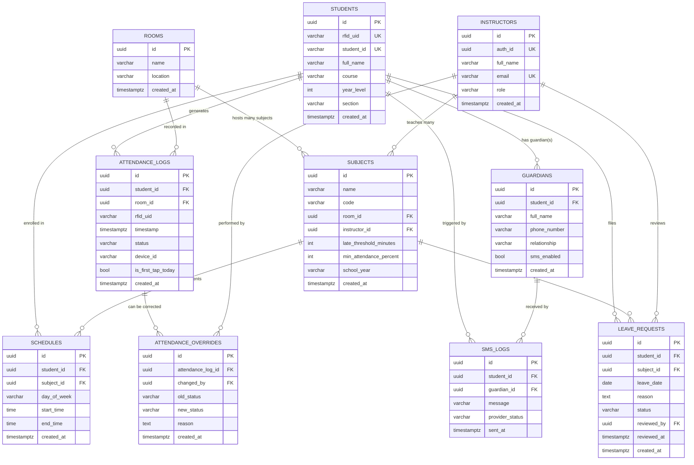
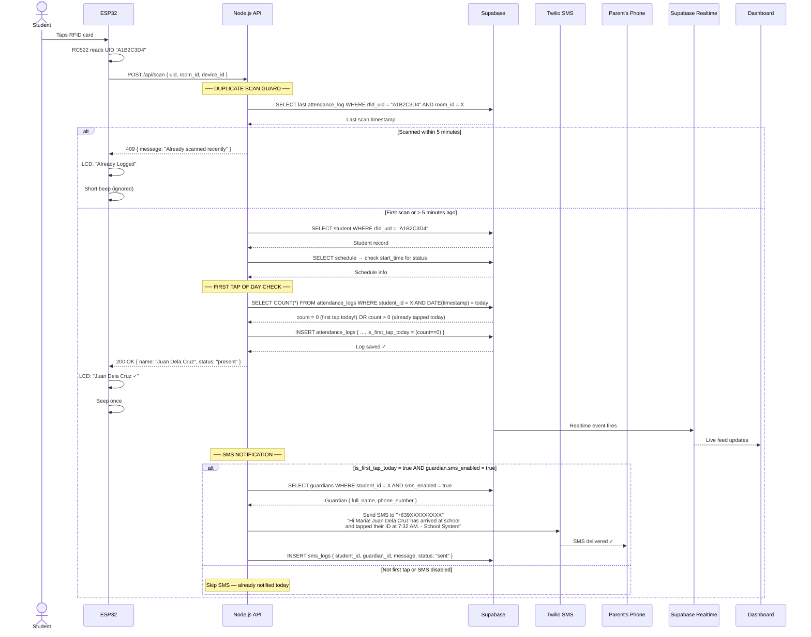
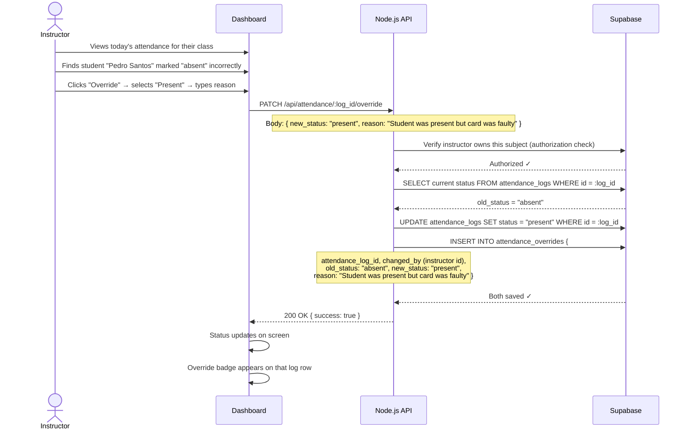
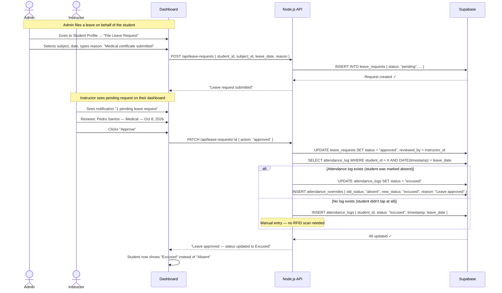
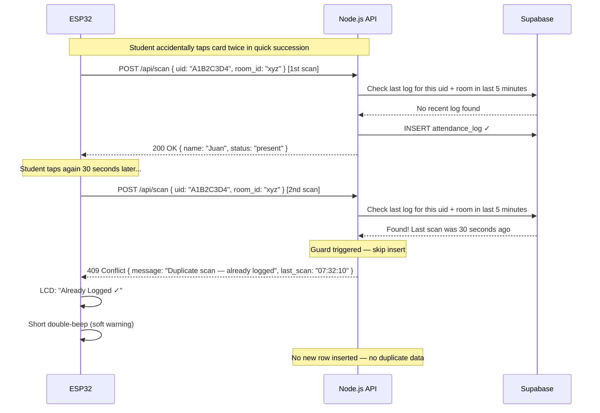
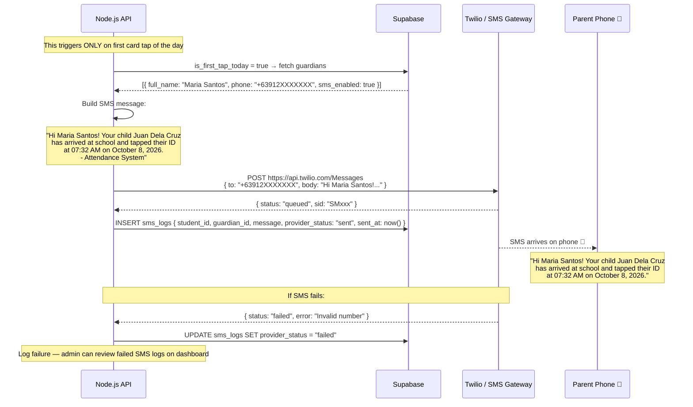

# Database ERD & Sequence Diagrams
## IoT Attendance Monitoring System — v3
### Confirmed Features Integrated

---

## 1. Confirmed Feature Set

| # | Feature | Status |
|---|---|---|
| 1 | Real-time live attendance dashboard | ✅ Core |
| 2 | Daily / Weekly / Monthly reports | ✅ Core |
| 3 | RFID Student Enrollment | ✅ Core |
| 4 | Role-Based Access (Admin / Instructor) | ✅ Core |
| 5 | **Manual Attendance Override** | ✅ Added |
| 6 | **Leave / Excuse Requests** | ✅ Added |
| 7 | **Duplicate Scan Guard** | ✅ Added |
| 8 | **SMS Notification to Parents (Conceptual)** | ✅ Added |

---

## 2. Entity Relationship Diagram (Full — 8 Tables)



---

## 3. Table Relationships at a Glance

```
INSTRUCTORS ──teaches──► SUBJECTS ──held in──► ROOMS
                              │                    │
                  (via SCHEDULES junction)          │
                              ▼                    ▼
                          STUDENTS ─────────► ATTENDANCE_LOGS
                              │                    │
                              │                    ├──► ATTENDANCE_OVERRIDES
                              │                    │       (manual corrections)
                              ▼                    │
                          GUARDIANS ◄──────── SMS_LOGS
                          (parents)           (first tap alert)
                              │
                              ▼
                         LEAVE_REQUESTS
                         (excused absences)
```

---

## 4. New Tables Explained

### 👪 GUARDIANS
> **"Every student can have one or more parents/guardians who receive SMS notifications."**

- `phone_number` — where the SMS goes (e.g., "+639XXXXXXXXX")
- `relationship` — `"Mother"`, `"Father"`, `"Guardian"`
- `sms_enabled` — toggle per guardian (some families may opt out)
- One student → One or more guardians

---

### 📝 ATTENDANCE_OVERRIDES *(Audit Trail)*
> **"Tracks every manual correction an instructor or admin makes to an attendance record."**

- `attendance_log_id` → the original scan log being corrected
- `changed_by` → which instructor made the change
- `old_status` / `new_status` → e.g., `"absent"` → `"present"`
- `reason` → required text explaining why (accountability)
- Protects data integrity — original log is **never deleted**, only a correction is added

---

### 📋 LEAVE_REQUESTS
> **"A student (filed by admin on their behalf) requests to be marked excused for a specific date and subject."**

- `status`: `"pending"` → `"approved"` or `"rejected"`
- `reviewed_by` → instructor who acted on it
- When **approved** → triggers an override on the related `attendance_log` (absent → excused)
- When **rejected** → original `absent` status remains

---

### 📱 SMS_LOGS
> **"Tracks every SMS notification sent — for auditing and preventing duplicate messages."**

- Linked to both the `student` and the specific `guardian` who received it
- `provider_status`: `"sent"`, `"failed"`, `"delivered"` (from Twilio callback)
- Used to check: *"Was an SMS already sent for this student today?"* before sending again

---

## 5. Cardinality Summary (Complete)

| Relationship | Type | Description |
|---|---|---|
| Student → Schedules | 1 to Many | One student, many class enrollments |
| Subject → Schedules | 1 to Many | One subject, many students enrolled |
| Student → Attendance Logs | 1 to Many | One student generates many scan records |
| Room → Attendance Logs | 1 to Many | One room's door logs many scans |
| Room → Subjects | 1 to Many | One room hosts many subjects |
| Instructor → Subjects | 1 to Many | One instructor teaches many subjects |
| Student → Guardians | 1 to Many | One student can have multiple guardians |
| Student → Leave Requests | 1 to Many | One student can file many leave requests |
| Instructor → Leave Requests | 1 to Many | One instructor reviews many requests |
| Attendance Log → Overrides | 1 to Many | One log can have correction history |
| Instructor → Overrides | 1 to Many | One instructor can make many corrections |
| Student → SMS Logs | 1 to Many | Many SMS events per student over time |
| Guardian → SMS Logs | 1 to Many | Many SMS messages per guardian |
| Students ↔ Subjects | Many to Many | Resolved via SCHEDULES |

---

## 6. Sequence Diagrams

### 6.1 — Student Taps Card (Core + Duplicate Guard + SMS)



---

### 6.2 — Manual Attendance Override



---

### 6.3 — Leave / Excuse Request Flow



---

### 6.4 — Duplicate Scan Guard Detail



---

### 6.5 — SMS Notification Concept (Parent View)



---

## 7. Full Database Schema (PostgreSQL / Supabase)

```sql
-- ============================================================
-- CORE TABLES
-- ============================================================

CREATE TABLE instructors (
  id          UUID PRIMARY KEY DEFAULT gen_random_uuid(),
  auth_id     UUID UNIQUE,
  full_name   VARCHAR(100) NOT NULL,
  email       VARCHAR(100) UNIQUE NOT NULL,
  role        VARCHAR(20) DEFAULT 'instructor', -- 'instructor' | 'admin'
  created_at  TIMESTAMPTZ DEFAULT now()
);

CREATE TABLE rooms (
  id          UUID PRIMARY KEY DEFAULT gen_random_uuid(),
  name        VARCHAR(100) NOT NULL,
  location    VARCHAR(200),
  created_at  TIMESTAMPTZ DEFAULT now()
);

CREATE TABLE subjects (
  id                       UUID PRIMARY KEY DEFAULT gen_random_uuid(),
  name                     VARCHAR(100) NOT NULL,
  code                     VARCHAR(20),
  room_id                  UUID REFERENCES rooms(id),
  instructor_id            UUID REFERENCES instructors(id),
  late_threshold_minutes   INTEGER DEFAULT 15,      -- configurable per subject
  min_attendance_percent   INTEGER DEFAULT 75,      -- for flagging
  school_year              VARCHAR(20),             -- e.g., "2026-2027"
  created_at               TIMESTAMPTZ DEFAULT now()
);

CREATE TABLE students (
  id          UUID PRIMARY KEY DEFAULT gen_random_uuid(),
  rfid_uid    VARCHAR(50) UNIQUE NOT NULL,
  student_id  VARCHAR(20) UNIQUE NOT NULL,
  full_name   VARCHAR(100) NOT NULL,
  course      VARCHAR(100),
  year_level  INTEGER,
  section     VARCHAR(20),
  created_at  TIMESTAMPTZ DEFAULT now()
);

CREATE TABLE schedules (
  id          UUID PRIMARY KEY DEFAULT gen_random_uuid(),
  student_id  UUID REFERENCES students(id) ON DELETE CASCADE,
  subject_id  UUID REFERENCES subjects(id) ON DELETE CASCADE,
  day_of_week VARCHAR(10) NOT NULL,
  start_time  TIME NOT NULL,
  end_time    TIME NOT NULL,
  created_at  TIMESTAMPTZ DEFAULT now()
);

CREATE TABLE attendance_logs (
  id                UUID PRIMARY KEY DEFAULT gen_random_uuid(),
  student_id        UUID REFERENCES students(id),
  room_id           UUID REFERENCES rooms(id),
  rfid_uid          VARCHAR(50) NOT NULL,
  timestamp         TIMESTAMPTZ DEFAULT now(),
  status            VARCHAR(20) DEFAULT 'present', -- 'present'|'late'|'excused'|'unknown'
  device_id         VARCHAR(50),
  is_first_tap_today BOOLEAN DEFAULT false,        -- triggers SMS if true
  created_at        TIMESTAMPTZ DEFAULT now()
);

-- ============================================================
-- FEATURE TABLES
-- ============================================================

-- Guardians (for SMS notifications)
CREATE TABLE guardians (
  id           UUID PRIMARY KEY DEFAULT gen_random_uuid(),
  student_id   UUID REFERENCES students(id) ON DELETE CASCADE,
  full_name    VARCHAR(100) NOT NULL,
  phone_number VARCHAR(20) NOT NULL,
  relationship VARCHAR(50),                        -- 'Mother', 'Father', 'Guardian'
  sms_enabled  BOOLEAN DEFAULT true,               -- opt-out toggle
  created_at   TIMESTAMPTZ DEFAULT now()
);

-- SMS notification log
CREATE TABLE sms_logs (
  id               UUID PRIMARY KEY DEFAULT gen_random_uuid(),
  student_id       UUID REFERENCES students(id),
  guardian_id      UUID REFERENCES guardians(id),
  message          TEXT NOT NULL,
  provider_status  VARCHAR(20) DEFAULT 'sent',    -- 'sent'|'failed'|'delivered'
  sent_at          TIMESTAMPTZ DEFAULT now()
);

-- Manual attendance corrections (audit trail)
CREATE TABLE attendance_overrides (
  id                 UUID PRIMARY KEY DEFAULT gen_random_uuid(),
  attendance_log_id  UUID REFERENCES attendance_logs(id),
  changed_by         UUID REFERENCES instructors(id),
  old_status         VARCHAR(20) NOT NULL,
  new_status         VARCHAR(20) NOT NULL,
  reason             TEXT NOT NULL,               -- required for accountability
  created_at         TIMESTAMPTZ DEFAULT now()
);

-- Leave / Excuse requests
CREATE TABLE leave_requests (
  id           UUID PRIMARY KEY DEFAULT gen_random_uuid(),
  student_id   UUID REFERENCES students(id),
  subject_id   UUID REFERENCES subjects(id),
  leave_date   DATE NOT NULL,
  reason       TEXT NOT NULL,
  status       VARCHAR(20) DEFAULT 'pending',     -- 'pending'|'approved'|'rejected'
  reviewed_by  UUID REFERENCES instructors(id),
  reviewed_at  TIMESTAMPTZ,
  created_at   TIMESTAMPTZ DEFAULT now()
);

-- ============================================================
-- INDEXES (for performance on large datasets)
-- ============================================================

CREATE INDEX idx_attendance_rfid_uid      ON attendance_logs(rfid_uid);
CREATE INDEX idx_attendance_student_id    ON attendance_logs(student_id);
CREATE INDEX idx_attendance_room_id       ON attendance_logs(room_id);
CREATE INDEX idx_attendance_timestamp     ON attendance_logs(timestamp DESC);
CREATE INDEX idx_leave_requests_student   ON leave_requests(student_id);
CREATE INDEX idx_leave_requests_status    ON leave_requests(status);
CREATE INDEX idx_sms_logs_student         ON sms_logs(student_id);
```

---

## 8. Duplicate Scan Guard — API Logic

> This is **not a table** — it's a check in the Node.js API before inserting a new log.

```javascript
// In POST /api/scan handler

const DUPLICATE_GUARD_MINUTES = 5;

// Check if this UID was already scanned in this room recently
const { data: lastScan } = await supabase
  .from('attendance_logs')
  .select('timestamp')
  .eq('rfid_uid', uid)
  .eq('room_id', room_id)
  .gte('timestamp', new Date(Date.now() - DUPLICATE_GUARD_MINUTES * 60 * 1000).toISOString())
  .order('timestamp', { ascending: false })
  .limit(1)
  .single();

if (lastScan) {
  // Duplicate detected — reject
  return res.status(409).json({
    message: 'Duplicate scan — already logged recently',
    last_scan: lastScan.timestamp
  });
}

// Not a duplicate — proceed with logging...
```

---

## 9. Data Flow Summary (All Features)

```
Student taps card
      │
      ▼
ESP32 reads UID → HTTP POST → Node.js API
      │
      ├─── DUPLICATE GUARD ──── Already scanned < 5 min? → Reject (409)
      │
      ├─── LOOKUP student by rfid_uid
      │
      ├─── CHECK schedule → determine: present / late / unknown
      │
      ├─── FIRST TAP TODAY? 
      │         YES → set is_first_tap_today = true
      │              → Fetch guardian → Send SMS via Twilio
      │              → Log to sms_logs
      │         NO  → Skip SMS
      │
      ├─── INSERT attendance_logs
      │
      └─── Supabase Realtime → Dashboard live update
                │
                ├── Instructor sees real-time feed
                │
                ├── Can OVERRIDE any record → attendance_overrides audit log
                │
                └── Admin can file LEAVE REQUEST → leave_requests
                          │
                          └── Instructor approves → status → "excused"
```

---

*Updated: 2026-10-08 | v3 — Manual Override + Leave Requests + Duplicate Guard + SMS Notification integrated*
